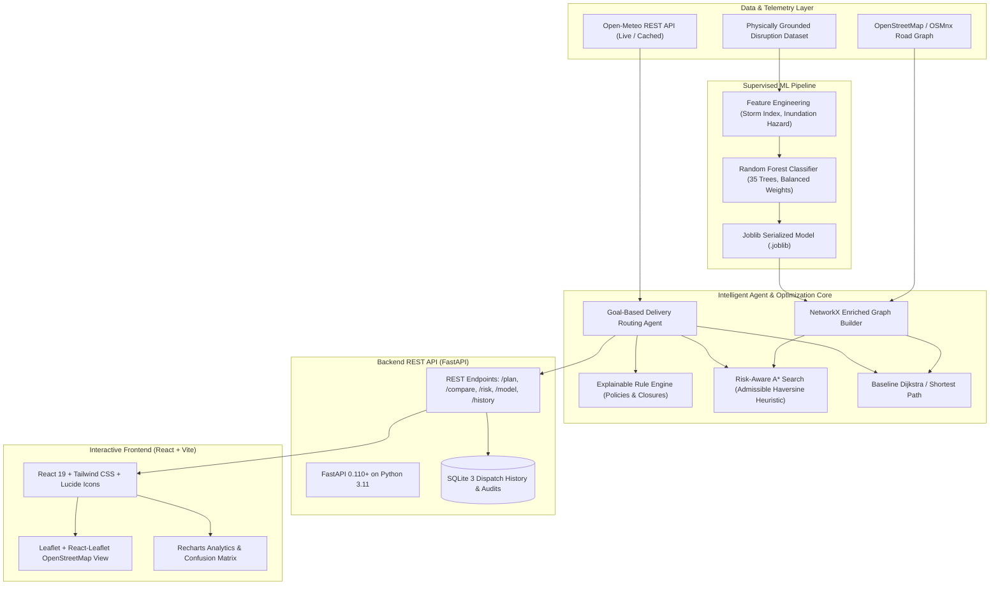

# System Architecture: Risk-Aware Essential Supply Delivery Route Planning

**Problem Statement ID:** SIH26002  
**Event:** Smart India Hackathon 2026

## 1. High-Level Architectural Diagram

## 2. Multi-Tier Architecture Details

### Tier 1: Client Application (React.js + Vite)
- Built on modern React with Vite and Tailwind CSS.
- **Interactive Geospatial Visualization**: Powered by `leaflet` and `react-leaflet`, rendering road networks color-coded by predicted hazard level (Green for Low Risk, Amber for Medium Risk, Red for High Risk, and Dark Dashed for Blocked Segments).
- **Analytical Dashboards**: Powered by `recharts` for category volume, feature importances, and trade-off metrics.
- **Interactive Routing Sandbox**: Enables operators to simulate adverse rainfall (0-150 mm/h) and wind speeds (0-120 km/h) in real time and test road closures dynamically.

### Tier 2: Application API (FastAPI)
- Modular routers:
  - `routes.py`: Route planning, benchmarking, and node directory.
  - `risk.py`: Network segments inventory, custom prediction, and dynamic closures.
  - `model.py`: Model evaluation scorecard and feature importances.
  - `dashboard.py`: Summary statistics and system data status.
- Strict Pydantic V2 request/response validation.

### Tier 3: Optimization & Intelligence Layer
- **Random Forest Classifier**: Predicts probability distribution across three risk classes: Low, Medium, High.
- **Risk-Aware A* Search**: Employs an admissible Haversine-normalized heuristic guaranteeing optimal path discovery.
- **Rule Engine**: Evaluates safety advisories, road closures, and data uncertainties to provide transparent decision explanations.
- **Goal-Based Agent**: Orchestrates the complete 9-stage delivery lifecycle.

### Tier 4: Storage & Persistence
- **SQLite 3**: Stores route execution requests, timestamps, recommended distances, travel times, safety scores, and full raw JSON payloads for reproducible review.
- **CSV Data Store**: Reproducible synthetic dataset (`road_disruption_dataset.csv`) and model metrics (`model_metrics.json`).
